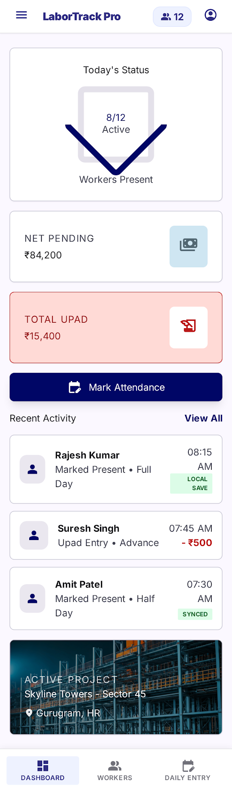
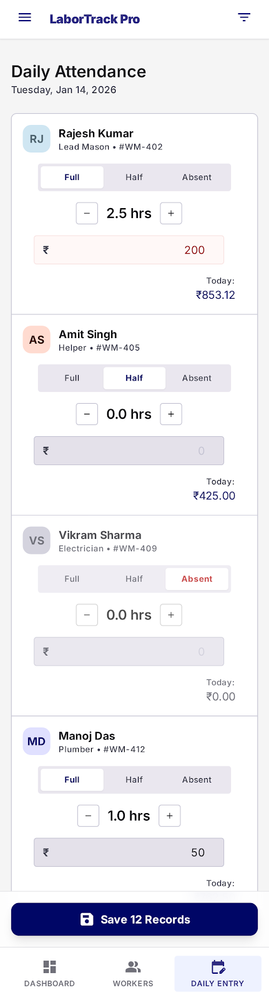
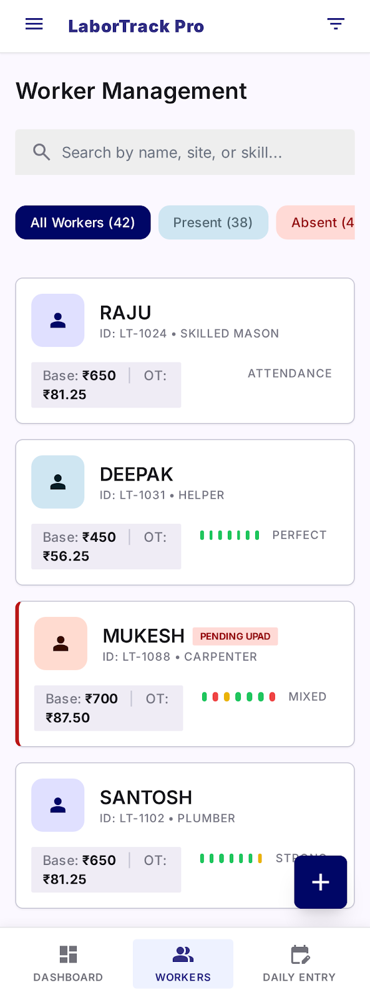
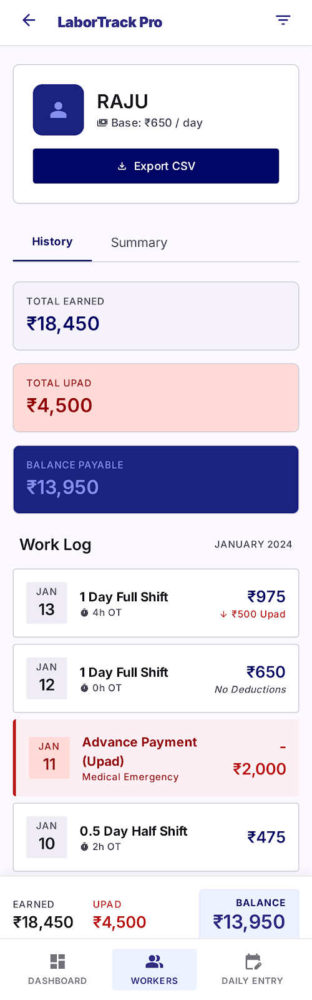

# ⚡ WageFlow

<p align="center">
  <strong>Fast, offline-first worker attendance, overtime (OT), advance payments, and wage management for workshops, factories, and small businesses.</strong>
</p>

<p align="center">
  <a href="https://github.com/sanket-sakariya/WageFLow/blob/main/LICENSE">
    
  </a>
  <a href="https://flutter.dev">
    
  </a>
  <a href="https://dart.dev">
    
  </a>
  <a href="https://github.com/sanket-sakariya/WageFLow/pulls">
    
  </a>
  <a href="https://github.com/sanket-sakariya/WageFLow/stargazers">
    
  </a>
</p>

---

## 📖 Overview

**WageFlow** is a modern, open-source attendance and payroll management application built with **Flutter**. Designed specifically for factories, manufacturing units, construction sites, workshops, and contractors who need a simple, reliable way to track daily muster rolls, overtime, and advances **without requiring an internet connection or costly subscriptions**.

All data is stored locally in an encrypted/private SQLite database on the device, ensuring complete data ownership and lightning-fast speed.

---

## ✨ Features

- 📅 **Daily Attendance Entry**: Record attendance (Full Day, Half Day, Absent) in a quick daily roster view.
- ⏱️ **Overtime (OT) Tracking**: Track additional working hours per worker with automated wage computation.
- 💵 **Advance Payments Ledger**: Log petty cash or wage advances given to workers on any date.
- 🧮 **Automated Wage Calculation**:
  $$\text{Net Pay} = (\text{Days Present} \times \text{Daily Rate}) + (\text{OT Hours} \times \text{Hourly OT Rate}) - \text{Advances}$$
- 👥 **Worker Directory**: Add and manage worker profiles, base daily rates, customized OT rates, and joining dates.
- 📊 **Detailed Worker History**: Inspect historical records, filter by month/date, and review individual worker payouts.
- 📤 **CSV Export & Share**: Export monthly attendance rolls and payroll statements to CSV for Excel/Sheets and share via email or messaging apps.
- 🔒 **100% Offline & Private**: Zero external cloud dependency. Your payroll and worker data remains safely on your device.

---

## 📱 Screenshots

<div align="center">
  <table>
    <tr>
      <td align="center"><b>Dashboard Overview</b></td>
      <td align="center"><b>Daily Attendance Entry</b></td>
    </tr>
    <tr>
      <td></td>
      <td></td>
    </tr>
    <tr>
      <td align="center"><b>Worker Directory</b></td>
      <td align="center"><b>Worker History & Ledger</b></td>
    </tr>
    <tr>
      <td></td>
      <td></td>
    </tr>
  </table>
</div>

---

## 🏗️ Tech Stack & Architecture

- **Framework**: [Flutter](https://flutter.dev) (Dart)
- **State Management**: [Provider](https://pub.dev/packages/provider)
- **Local Database**: [SQLite via sqflite](https://pub.dev/packages/sqflite)
- **File & Export**: [csv](https://pub.dev/packages/csv), [share_plus](https://pub.dev/packages/share_plus), [path_provider](https://pub.dev/packages/path_provider)
- **Formatting**: [intl](https://pub.dev/packages/intl)
- **UI Guidelines**: Material 3 with industrial theme tokens

---

## 📁 Project Structure

```text
WageFlow/
├── lib/
│   ├── database/          # SQLite database helper & schema
│   ├── models/            # Worker & AttendanceRecord data models
│   ├── screens/           # UI Screens (Dashboard, Daily Entry, Workers, History)
│   ├── services/          # State management (AppState), SalaryCalculator, CSV export
│   ├── theme/             # Material 3 theme definitions
│   ├── widgets/           # Reusable UI components & bottom sheets
│   └── main.dart          # Application entry point
├── test/                  # Unit and widget tests
├── assets/                # App icons & static assets
├── screenshots/           # Application preview screenshots
├── sample_data/           # Sample payroll spreadsheets for testing
├── design/                # UI mockups and design documentation
└── pubspec.yaml           # Flutter package dependencies & configuration
```

---

## 🚀 Getting Started

### Prerequisites

Ensure you have the following installed:
- [Flutter SDK](https://flutter.dev/docs/get-started/install) (`>= 3.11.3`)
- [Dart SDK](https://dart.dev)
- Android Studio / VS Code with Flutter extension
- An Android device, emulator, or desktop runner

### Installation

1. **Clone the repository**:
   ```bash
   git clone https://github.com/sanket-sakariya/WageFLow.git
   cd WageFLow
   ```

2. **Install dependencies**:
   ```bash
   flutter pub get
   ```

3. **Run unit tests**:
   ```bash
   flutter test
   ```

4. **Launch the application**:
   ```bash
   flutter run
   ```

---

## 🤝 Contributing

Contributions are warmly welcome! Whether you want to fix a bug, add a new feature, or improve localization:

1. Check out the [Contributing Guidelines](CONTRIBUTING.md).
2. Fork the repository and create your feature branch:
   ```bash
   git checkout -b feature/amazing-feature
   ```
3. Commit your changes and push:
   ```bash
   git push origin feature/amazing-feature
   ```
4. Open a Pull Request on GitHub.

---

## 📄 License

This project is open-source and licensed under the [MIT License](LICENSE) - see the [LICENSE](LICENSE) file for details.

---

## 💬 Community & Support

- Found a bug or have a suggestion? [Open an Issue](https://github.com/sanket-sakariya/WageFLow/issues)
- If you find this project helpful, give it a ⭐️ on [GitHub](https://github.com/sanket-sakariya/WageFLow)!
